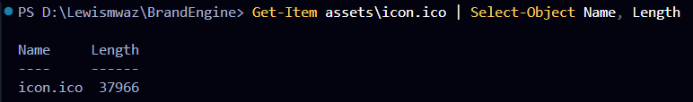
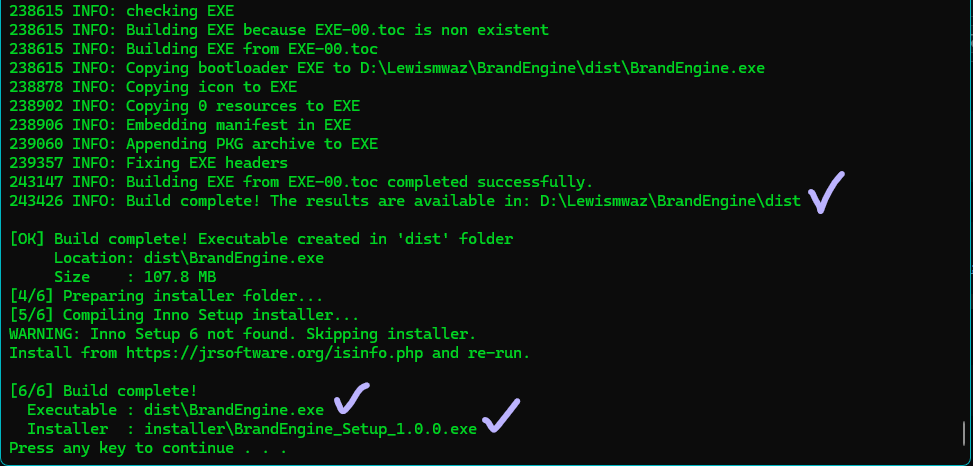
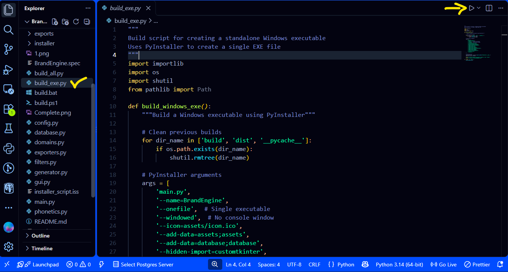
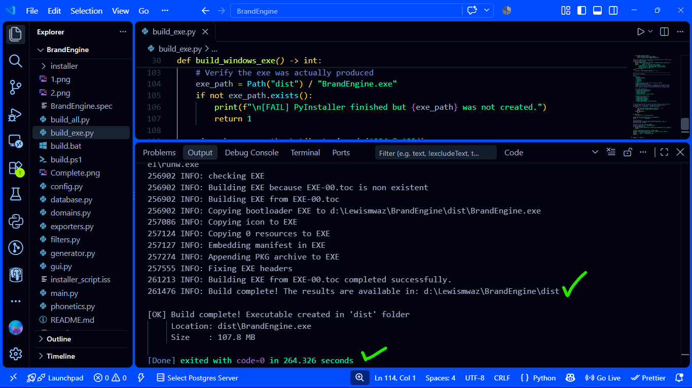
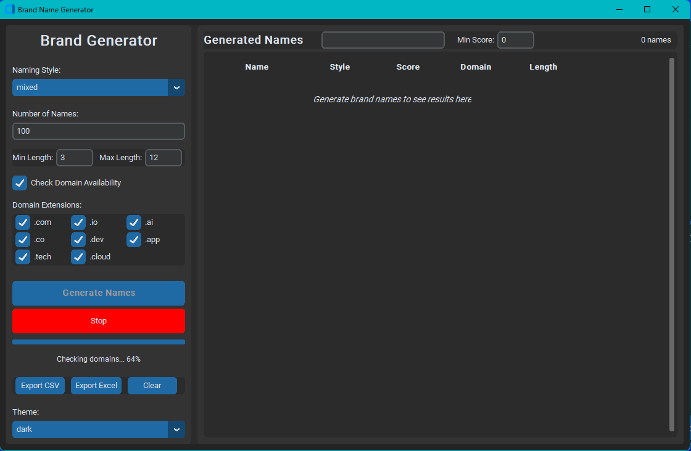

# Brand Engine - AI-Powered Brand Name Generator


A sophisticated brand name generator with domain availability checking, scoring, and export capabilities.

## Features
-  **Modern GUI** - Built with CustomTkinter for a polished look
-  **Smart Generation** - Multiple naming styles (compound, abstract, animal, nature)
-  **Domain Checking** - Real-time WHOIS/RDAP domain availability
-  **Intelligent Scoring** - Scores names based on phonetics, memorability, and brand appeal
- **Similarity Filtering** - Removes duplicate and similar names
-  **Database Storage** - SQLite database for persistence
-  **Export Options** - CSV, JSON, and Excel export
-  **Multi-threaded** - Fast generation without UI freezing
- **Live Filtering** - Search and filter results in real-time

## Installation
1. Clone the repository:
```bash
git clone https://github.com/Yavotu/BrandEngine.git
cd BrandEngine
```
2. Convert `png logo` to `icon`. From root (`BrandEngine`), open terminal and run:
   ```python
   python -m pip install Pillow
   python -c "from PIL import Image; img = Image.open('assets/logo.png').convert('RGBA'); img.save('assets/icon.ico', sizes=[(256,256),(128,128),(64,64),(48,48),(32,32),(16,16)])"
   ```

**Verify it worked:**
```powershell
Get-Item assets\icon.ico | Select-Object Name, Length
```


- You should see a file a few KB in size. Open it in Explorer — you should see the logo icon.

3. Ensure you have latest pip and Python 3.10+ installed and both added to PATH then double click to open the `build.bat` or well known as `build` Windows Batch File and let it install all the required Python dependencies and also generate the executable file.



4. Incase you get errors, download **`vc_redist.x64.exe`** from [https://aka.ms/vs/17/release/vc_redist.x64.exe](https://aka.ms/vs/17/release/vc_redist.x64.exe) into the project root.

5. Build via terminal:
   ```python
   python build_exe.py
   ```
 
 OR 
 
 - run `build_exe.py`:
 




### User Interface



## License
- This project is licensed under the GNU License. View License [here](https://github.com/Yavotu/BrandEngine/blob/main/LICENSE).  
More details about the MIT License can be found [here.](https://choosealicense.com/licenses/mit/)

## Contact
- For any inquiries, please contact:
- Email - <eappointmaster@gmail.com> or <yavotu@gmail.com>
- GitHub -  [@Yavotu](https://github.com/Yavotu) or [@Lewismwaz](https://github.com/Lewismwaz)

[BrandEngine](https://github.com/Yavotu/BrandEngine) **©** 2026, All Rights Reserved
